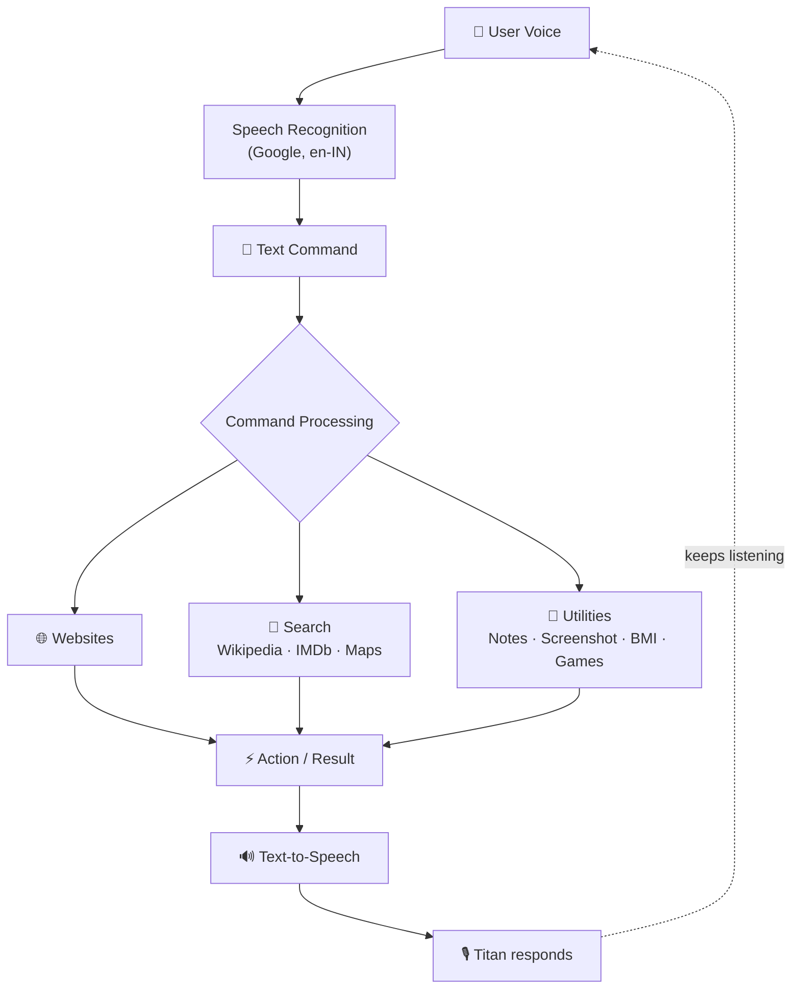

<div align="center">


<br/>

**A Python-powered voice assistant that listens, understands, speaks, and performs everyday desktop tasks.**

*Built from scratch using Python, speech recognition, text-to-speech, automation, and external APIs.*

<br/>


<br/>

[Features](#-features) &nbsp;•&nbsp; [How It Works](#-how-titan-works) &nbsp;•&nbsp; [Commands](#-command-cheat-sheet) &nbsp;•&nbsp; [Quick Start](#-quick-start) &nbsp;•&nbsp; [Roadmap](#-roadmap) &nbsp;•&nbsp; [Author](#-author)

</div>

---

## ✨ Overview

**Titan** is a voice-based virtual assistant built with Python that lets you control your computer using natural voice commands.

Instead of relying entirely on the keyboard and mouse, Titan captures your voice through the microphone, converts it to text, performs the requested action, and replies using synthesized speech.

From opening websites and reading Wikipedia summaries to taking notes, capturing screenshots, searching movies, calculating BMI, and playing Rock Paper Scissors, Titan brings many everyday utilities together into a single voice-controlled assistant.

> 🎯 **Project goal:** explore how Python can combine speech recognition, text-to-speech, web services, desktop automation, and decision logic into one interactive application.

---

## 🚀 Features

| | Feature | What it does |
|---|---|---|
| 🎤 | **Voice Interaction** | Listens through your mic and replies with speech |
| 🌐 | **Web & Information** | Opens popular sites, reads Wikipedia, finds places on Google Maps |
| 🎬 | **Movie Search** | Looks up titles, ratings, and plots via IMDb |
| 📝 | **Voice Notes** | Dictate, save, and read back notes |
| 📸 | **Screenshots** | Captures your screen by voice command |
| 🧮 | **BMI Calculator** | Calculates BMI and its category from spoken input |
| 🎮 | **Rock Paper Scissors** | Plays against you |
| 😄 | **Entertainment** | Jokes, casual chat, and self-introduction |
| ⏰ | **Time & Greetings** | Time-aware greetings and spoken time |

### 🎤 Voice Interaction

Titan listens for commands through your microphone and converts speech to text using Google's speech recognition service.

- 🎙️ Voice-based command input
- 🧠 Speech-to-text conversion
- 🇮🇳 English (India) recognition support
- 🔊 Spoken responses via text-to-speech
- ⏱️ Configurable listening timeout

### 🌐 Web & Information

Titan connects to several popular online services directly from voice commands.

| Command | Action |
|---|---|
| `Open Google` | Opens Google |
| `Open YouTube` | Opens YouTube |
| `Open Amazon` | Opens Amazon India |
| `Open Gmail` | Opens Gmail |
| `Open StackOverflow` | Opens StackOverflow |
| `Wikipedia <topic>` | Reads a short Wikipedia summary |
| `Where is <place>` | Opens the location in Google Maps |

### 🎬 Movie Search

Titan integrates with the **IMDb database**. Ask it about a movie and it can retrieve:

- 🎥 Title
- 📅 Release year
- ⭐ IMDb rating
- 📖 Plot summary

It also distinguishes between movies that have already been released and upcoming releases.

### 📝 Voice-Controlled Notes

Create and read text notes entirely by voice.

- ✍️ Dictate a note
- 🕐 Optionally include the current time
- 💾 Save it to a local text file
- 📖 Read previously saved notes

Notes are stored locally in `titan.txt`.

### 📸 Screenshot Automation

```text
"Take a screenshot"  →  Titan asks for a filename  →  3-second delay  →  Screenshot captured  →  Saved as PNG
```

The screenshot is saved using the filename you provide.

### 🧮 BMI Calculator

Titan asks for your **height (cm)** and **weight (kg)**, then calculates:

```text
BMI = weight / height²
```

and tells you the matching BMI category.

### 🎮 Rock Paper Scissors

Need a break? Titan randomly picks **Rock**, **Paper**, or **Scissors**, compares it with your choice, and announces the result.

### 😄 Entertainment, Time & Greetings

- 😂 Tells jokes using `pyjokes`
- 💬 Responds to casual conversation
- 🤖 Introduces itself
- 👋 Greets you with **Good Morning**, **Good Afternoon**, or **Good Evening** based on the time of day
- ⏰ Tells you the current time on request

---

## 🧠 How Titan Works

The core loop is a simple pipeline: **Speech → Processing → Action → Response.**



The main loop continuously listens for input and matches recognized phrases to the available actions.

---

## 💬 Command Cheat Sheet

<details open>
<summary><b>Try saying any of these</b></summary>

<br/>

| Category | Say this |
|---|---|
| 🙋 **Chat** | "How are you?" · "Who are you?" · "Tell me a joke" |
| 🌐 **Web** | "Open Google" · "Open YouTube" · "Open Gmail" · "Open Amazon" · "Open StackOverflow" |
| 📚 **Info** | "Wikipedia Python" · "Where is Chennai" · "What is the time?" |
| 📝 **Notes** | "Write a note" · "Show note" |
| 🧰 **Utilities** | "Take a screenshot" · "Calculate my BMI" |
| 🎬 **Movies** | "Tell me about a movie" |
| 🎮 **Games** | "Play a game" |
| 🚪 **Exit** | "Exit" |

</details>

---

## 🧰 Tech Stack

**Language:** Python 🐍

| Library | Purpose |
|---|---|
| `pyttsx3` | Text-to-speech |
| `SpeechRecognition` | Speech-to-text |
| `datetime` | Date and time operations |
| `os` | System-level operations |
| `webbrowser` | Opening websites |
| `wikipedia` | Wikipedia searches |
| `random` | Random computer choices |
| `pyjokes` | Generating jokes |
| `time` | Delays and timing |
| `pyautogui` | Screenshot automation |
| `imdb` | Movie database searches |

---

## ⚡ Quick Start

### 1. Clone the repository

```bash
git clone https://github.com/srinidhiramesh24/voice-based-virtual-assistant.git
cd voice-based-virtual-assistant
```

### 2. Install dependencies

```bash
pip install pyttsx3 SpeechRecognition wikipedia pyjokes pyautogui imdbpy
```

Depending on your system, you may also need:

```bash
pip install PyAudio
```

> 🎤 **Note:** microphone access is required for speech recognition.

### 3. Run Titan

```bash
python "Voice-based Virtual Assistant.py"
```

Titan starts by greeting you and asking what it should call you. After that, just speak a supported command.

<details>
<summary><b>🛟 Troubleshooting: PyAudio won't install</b></summary>

<br/>

`PyAudio` can fail to build on some Windows setups. If `pip install PyAudio` errors out, try upgrading `pip` first, or install a prebuilt PyAudio wheel that matches your Python version.

</details>

---

## 🔧 Configuration

Some features depend on local paths set inside the Python file. For example, opening Microsoft Word uses a Windows installation path, and music playback uses a local music file path.

**Before running the project, update these paths to match your system:**

```python
# Application to launch (e.g., Microsoft Word)
npath = "C:\\Path\\To\\Your\\Application.exe"

# Music file to play
npath = "C:\\Path\\To\\Your\\Music.mp3"
```

---

## 🖥️ Platform

Titan currently contains Windows-specific functionality, including:

- Windows Speech API (`sapi5`) for text-to-speech
- Windows application launching
- Windows-specific application paths

The current implementation is therefore primarily intended for **Windows**.

---

## 🔐 Permissions & Requirements

Titan may require access to:

| | Permission | Used for |
|---|---|---|
| 🎤 | Microphone | Listening to your commands |
| 🖥️ | Desktop / application controls | Launching apps and automation |
| 📸 | Screen capture | Taking screenshots |
| 🌐 | Internet | Speech recognition, Wikipedia, and IMDb searches |

---

## 📁 Project Structure

```text
Voice-Based-Virtual-Assistant/
│
├── Voice-based Virtual Assistant.py   # Main assistant script
├── titan.txt                          # Created when you use the note-taking feature
└── README.md
```

---

## 🧩 Concepts Demonstrated

| | | |
|---|---|---|
| 🐍 Python programming | 🔀 Conditional statements | 🔁 Loops |
| 🧩 Functions | 📦 External libraries | 🎤 Speech recognition |
| 🔊 Text-to-speech | 🌐 Web automation | 📂 File handling |
| 🎲 Randomization | 🖥️ Desktop automation | 🕐 Date & time handling |
| 🔎 API / library-based retrieval | 🧠 Command processing | 🔄 Continuous command loop |

---

## 🧭 Roadmap

Titan can grow well beyond its current form. Planned and possible improvements:

**🧠 Smarter understanding**
- [ ] More flexible natural-language command processing
- [ ] Better command intent detection
- [ ] Conversational memory
- [ ] Integration with modern AI / LLM APIs

**🔌 More capabilities**
- [ ] Music search and playback
- [ ] Voice-controlled email
- [ ] Calendar and reminder integration
- [ ] Weather information
- [ ] More API integrations

**🏗️ Engineering & experience**
- [ ] Graphical user interface
- [ ] Modular command architecture
- [ ] Asynchronous command processing
- [ ] User authentication
- [ ] Improved multilingual speech recognition

---

## 🎯 What I Learned

Building Titan showed me how different Python technologies fit together into one interactive application.

**Speech → Processing → Action → Response**

Hands-on experience with:

- Working with external Python packages
- Handling microphone input
- Converting speech into text
- Generating spoken responses
- Working with files
- Automating desktop actions
- Interacting with web services
- Implementing conditional command logic
- Building a continuous, event-driven command loop

---

## 🤝 Contributing

Ideas, issues, and feature requests are welcome. Feel free to open an issue or submit a pull request.

---

## 👤 Author

<div align="center">

### Srinidhi Ramesh

B.Tech Information Technology Student · Chennai Institute of Technology, Chennai 🇮🇳

Interested in Software Development, AI/ML, Problem Solving & Open Source

[](https://github.com/srinidhiramesh24)

</div>

---

## ⭐ Support

If you found this project interesting, consider giving the repository a ⭐. It helps the project and keeps me motivated to keep building.

<div align="center">

<br/>

**🎙️ "Your voice. Your commands. Your assistant."**

Built with Python 🐍 &nbsp;|&nbsp; Powered by Voice 🎤 &nbsp;|&nbsp; Meet Titan 🤖


</div>
